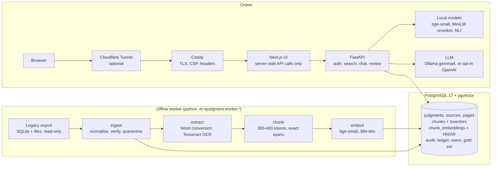

# E-Judgment RAG: architecture

E-Judgment is a research assistant over about 8,800 Ghanaian judgments from GhaLII's CC BY-NC 4.0 export. A lawyer can search by citation, case name, phrase or a description of the facts, or ask a question. Answers are built only from statements that the system has checked against the actual passages, and every statement links to the passage it relies on. The binding design contract is [AGENTS.md](../AGENTS.md); this page is the overview.

## Components

There are two processes in one repository: an **offline worker** that builds the index and an **online API** that serves it, with a Next.js UI in front. Everything runs in Docker Compose on one machine. Embeddings, reranking and verification run locally, and generation does too unless OpenAI is opted into.

## 1. Ingestion (offline, idempotent)

1. **Import** (`worker.ingest`) reads the export read-only. It normalises citations, dates, courts and judges, and keys each judgment by its AKN URI, which gives it a deterministic `uuid5` id. It then verifies each downloaded file by its signature, hash and a character n-gram match against the export's text. Rows that can't be trusted are quarantined with a reason code, e.g. the 551 "PocketLaw" placeholder pages. Every source carries its `rights_status`; only `cc_by_nc_local_export` and `licensed` sources are eligible.
2. **Extract** (`worker.extract`) converts Word files and OCRs scanned PDFs page by page. Each page records its extraction method, OCR confidence and extractor version. A page number is marked **verified** only when the file is proven to belong to the record.
3. **Chunk** (`worker.chunk`) splits one source per judgment along paragraphs, within the 512-token model limit (about 300–400 bge tokens). Each chunk is an exact character span of the source text, so quotes stay verbatim, and it carries a `page_reference_status`. Postgres generates English and "simple" full-text vectors for each chunk.
4. **Embed** (`worker.embed`) embeds each chunk with a context prefix (title, court, year) using `ctx-v1`. The hash of the exact input string decides when a vector must be rebuilt, so changed metadata re-embeds the chunk and stale vectors are never used.

Each stage skips work whose hashes are unchanged, so re-running the pipeline changes nothing.

## 2. Retrieval (`POST /v1/search`)

1. **Query analysis:** detects exact citations (`[2019] GHASC 12`) and case names (`X v Y`). Filters for court, jurisdiction, years and judge are strict and never widened.
2. **Three channels:**
   - **Lexical:** Postgres full-text search using `ts_rank_cd` over the `english` and `simple` configurations.
   - **Dense:** cosine similarity over the HNSW index, with BGE's query-instruction prefix on the query.
   - **Exact:** citation and trigram case-name lookup.

   Each channel returns a fixed-size pool, at most `passages_per_case` (3) passages per case, so pages of results stay stable.
3. **Fusion:** Reciprocal Rank Fusion (k=60) merges the channels. Passages are matched across re-published copies of the same judgment.
4. **Rerank:** the MiniLM cross-encoder rescores the top 30 passages.
5. **Grouping:** passages are grouped into cases, and judgments re-published under several URIs collapse into one case that lists them all.

Exact citation matches rank first, then case names, then the fused ranking. If a model or vectors are missing, the response says so (`degraded`); it never silently switches mode.

## 3. Generation and verification (`POST /v1/chat`, `/v1/chat/stream`)

1. **Retrieve:** hybrid search with reranking. For a citation or case-name match, the judgment's closing chunks are added too, because that is where the decision usually is.
2. **Select:** up to 8 passages (2 per case, about 4,000 tokens), sent to the model as `<source id="S1">` envelopes. Passage text is treated as untrusted and cannot forge an envelope.
3. **Generate:** the LLM must return JSON matching a schema: `{abstain, claims[{text, kind, sources, quote}], limitations}`.
4. **Verify each claim.** A claim is kept only if:
   - its sources were among the passages sent;
   - its quote (at least 4 words) appears verbatim in a passage it cites;
   - it adds no citation absent from those passages, and no page reference at all;
   - its cited passage entails it: either the claim copies the passage verbatim, or an NLI cross-encoder (`nli-deberta-v3-base`) judges it entailed (probability ≥ 0.5) by a window of 1–3 sentences from that passage.
5. **Build the answer** on the server from the kept claims. Citations, GhaLII links and page pinpoints come from the database, and pinpoints appear only for verified pages.
6. **Abstain** when retrieval finds nothing, the model declines, no claim survives or the output is invalid. An abstention still lists the cases that matched.

The streaming route reports progress (searching, drafting, checking) and stops generation if the user cancels. Each model call writes an `llm_usage_ledger` row. OpenAI calls also pass a budget soft stop, by default 20 calls or $1 per run.

## 4. Serving, security and operations

- **Accounts:** invite-only. Passwords are hashed with Argon2id; sessions are stored only as SHA-256 hashes. Sign-in is locked per email after 5 failures.
- **UI:** keeps the token in an HttpOnly cookie, calls the API only server-side and checks the `Origin` of chat requests.
- **Audit:** every search and question writes a hashed `query_audit` row (raw text only if explicitly enabled). Retention jobs delete old audit, auth and usage rows.
- **Proxy:** Caddy sets the CSP and security headers, and passes the answer stream through unbuffered. Cloudflare Tunnel is optional for public access.
- **Operations:** backup, restore and restore-drill scripts; CI runs ruff, mypy, pytest against pgvector, the UI checks and a proxy stream check.
- **Attribution:** every view of corpus content credits GhaLII and links the original judgment.

## 5. Evaluation loop

- `evals/gold.jsonl` holds 60 engineer-drafted questions, still unreviewed.
- `worker.evaluate` measures Recall@20, MRR@10 and latency for each retrieval mode.
- `worker.evaluate_answers` measures answer rate, evidence precision, abstention and how many claims survive verification.
- Each run stores its models, settings and a fingerprint of the corpus in `evaluation_runs`.
- Lawyers review the questions at `/review`; metrics are reported again over approved questions only.
- On the draft set, hybrid search with reranking reaches Recall@20 0.88 and MRR@10 0.63 (provisional).
